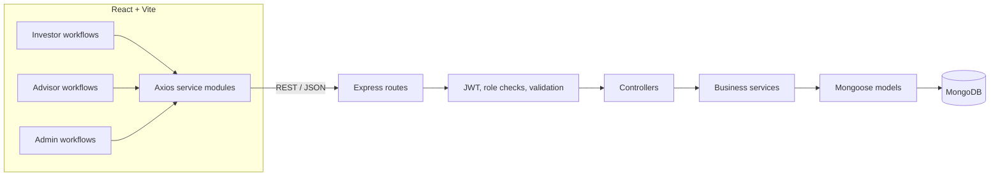

# MicroGrow

MicroGrow is a competition-ready MERN project that simulates a micro-investment and round-up savings experience for educational use only.

## Stack

- Frontend: React + Vite
- Backend: Node.js + Express
- Database: MongoDB + Mongoose
- Auth: JWT + bcrypt

## Implemented features

- JWT registration/login with bcrypt-hashed passwords and investor, advisor, and admin roles
- Investor workflows for demo banking, transactions, round-ups, risk profiles, virtual allocation and portfolio tracking, goals, notifications, and advisor messages
- Advisor views for assigned investors and their simulated portfolio, goals, and messages
- Admin dashboard and reporting, mock KYC review, and simulated market-data management
- Development-only, idempotent demo-data seeding

All financial and identity data is fictional simulation data. The application does not connect to real banks, execute real trades, or provide investment advice.

## Architecture



The investor flow covers demo transactions, server-calculated round-ups, saved risk profiles, virtual allocation, portfolio history, goals, notifications, and advisor messaging. Advisors see assigned clients; admins review mock KYC and manage simulated market data.

## Phased build strategy

Build and validate one phase at a time, in order:

```text
Phase 0 -> 1 -> 2 -> 3 -> 4 -> 5 -> 6 -> 7 -> 8 -> 9 -> 10
   -> 11 -> 12 -> 13 -> 14 -> 15 -> 16 -> 17 -> 18 -> 19 -> 20
```

For a fresh repository, begin with Phase 0 (repository setup) and Phase 1 (backend foundation); validate both before starting Phase 2. This repository already contains the later phases, so continue from the current implementation rather than regenerating completed work.

For each phase, inspect the existing code and tests, implement only that phase, run its focused tests and end-to-end flow, review the result for confirmed issues, then commit the validated changes. Avoid generating the whole application in one pass; incremental work reduces broken imports, duplicate APIs, mismatched schemas, and incomplete features.

## Local development

1. Install dependencies:
   - `npm install`
2. Copy `server/.env.example` to `server/.env` and set a local `MONGODB_URI` and strong `JWT_SECRET`.
3. Start the backend:
   - `npm --prefix server run dev`
4. Start the frontend:
   - `npm --prefix client run dev`

The client defaults to `http://localhost:5000/api`; set `VITE_API_URL` in `client/.env` only if the API runs elsewhere.

## Notes

- This project is a simulation and does not connect to real banks or execute real trades.
- Keep secrets in environment files such as `server/.env` and never commit real credentials.

## Validation

Run the backend integration suite and frontend quality gates with:

```powershell
npm --prefix server test -- --test-concurrency=1
npm --prefix client run lint
npm --prefix client run build
```

## Demo seed data

The development-only seed script creates or updates the documented fictional demo accounts and related sample data. It does not delete existing records and can be rerun safely.

1. Copy `server/.env.example` to `server/.env` if you have not already.
2. Set `DEMO_SEED_ENABLED=true` and choose a local-only `DEMO_SEED_PASSWORD` (8–72 UTF-8 bytes) in `server/.env`.
3. Run `npm --prefix server run seed:demo`.

The accounts are `investor@microgrow.demo`, `investor2@microgrow.demo`, `advisor@microgrow.demo`, and `admin@microgrow.demo`; they share the password configured in `DEMO_SEED_PASSWORD`. The script refuses to run with `NODE_ENV=production`. Never use the demo password outside a local development database.
